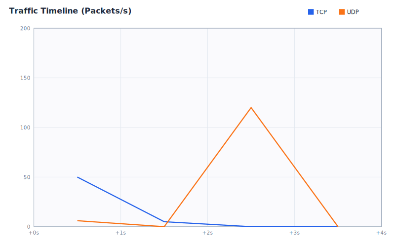

# pcapstat

**pcapstat** is a command-line tool for Linux, written in C11. It analyzes TCP and UDP traffic in one or more `.pcap` capture files. For each run it writes four PNG charts and a multi-page PDF report covering traffic statistics, top talkers, ports, flows and detected network anomalies.

The project was built as the qualification task for the *Best Coding Marathon* hackathon.

<p align="center">
  
  
</p>

## Key features

- **Multi-file input.** Several captures are merged into a single analysis. The same file given twice (by another path, a symlink or a hard link) is skipped with a warning, so counters are never doubled.
- **Link layers:** Ethernet II (including 802.1Q and QinQ VLAN tags), Linux cooked capture (`SLL` and `SLL2`) and raw IP. Both IPv4 and IPv6 are supported.
- **Safe parsing.** Every header read is bounds-checked against `caplen` and copied with `memcpy()` (no unaligned pointer casts). Packets with truncated or illegal headers are counted as malformed instead of crashing the tool. Non-IP frames (ARP, LLDP, STP, ...) get their own counter, IPv4 non-first fragments are never decoded as TCP/UDP, and TSO/BIG TCP frames with an IP length of 0 take their length from the frame.
- **Damaged captures.** A file that ends in a truncated or corrupt record (for example a capture killed with Ctrl-C) is still analyzed up to that point: the tool prints a warning, adds a *Capture Integrity* finding and exits `0`.
- **Streaming statistics.** Packets are never kept in memory. Hosts, ports, flows and one-second time buckets are stored in sparse hash tables, so memory grows with the number of distinct entities, not with capture length. A host stores up to 16 probed ports inline and allocates an 8 KB port bitmap only when it probes more.
- **Traffic characteristics:** protocol mix, packet-size histogram, TCP flag counts, Top-10 hosts, destination ports (with service names) and directional flows, plus TCP retransmission and out-of-order detection.
- **Eight anomaly heuristics:** port scan, SYN flood, retransmissions, RST spike, suspicious TCP flags, UDP burst, malformed packets and capture integrity.
- **Cairo rendering.** The same drawing code produces the standalone PNGs and the vector charts embedded in an A4 PDF report, which has automatic text wrapping and pagination.
- **Hardened build.** The code compiles with no warnings under `-Wall -Wextra -Wpedantic -Wshadow` (`-Werror` in the debug, ASan and test builds). The release build adds `-D_FORTIFY_SOURCE=2 -fstack-protector-strong`. Unit and integration tests run under AddressSanitizer and UndefinedBehaviorSanitizer with every finding fatal, and a Valgrind target is provided.

## Architecture

```text
        .pcap file(s)
              │
              ▼
   ┌──────────────────────┐
   │        Parser        │
   │       libpcap        │
   └──────────────────────┘
              │ parsed_packet_t (callback)
              ▼
   ┌──────────────────────┐
   │     Stats Engine     │
   │      hash tables     │
   └──────────────────────┘
              │ stats_ctx_t
              ▼
   ┌──────────────────────┐
   │   Anomaly Detector   │
   └──────────────────────┘
              │ anomaly_list_t
              ▼
   ┌──────────────────────┐
   │    Cairo PNG / PDF   │
   │  charts.c, report.c  │
   └──────────────────────┘
```

| Module | Header | Responsibility |
| :--- | :--- | :--- |
| CLI | [`include/cli.h`](include/cli.h) | `getopt_long()` parsing, input validation, duplicate-input removal, output-directory creation |
| Parser | [`include/parser.h`](include/parser.h) | Opens captures with `pcap_open_offline()`, decodes L2/L3/L4 and calls a callback for every frame; reports truncated files |
| Hash table | [`include/hashtable.h`](include/hashtable.h) | Generic hash table with separate chaining (FNV-1a hash with a murmur3 `fmix64` finalizer, resizes above a 0.7 load factor) |
| Stats | [`include/stats.h`](include/stats.h) | Global counters, time series, hosts, ports, flows, retransmissions, Top-N rankings |
| Anomaly | [`include/anomaly.h`](include/anomaly.h) | Threshold-based heuristics; findings sorted by severity |
| Charts | [`include/charts.h`](include/charts.h) | Four charts drawn onto any `cairo_t` (used for both PNG and PDF) |
| Report | [`include/report.h`](include/report.h) | A4 PDF report with summary, tables, charts and anomaly pages |

### Key engineering choices

The full design notes are in [`ARCHITECTURE.md`](ARCHITECTURE.md).

- **Unified error handling.** Every public function returns `0` on success or a negative value from `enum pcapstat_err` (`PCAPSTAT_ERR_ARGS`, `_IO`, `_PCAP`, `_NOMEM`, `_RENDER`). Resources are released through a single `goto cleanup` path.
- **Explicit memory ownership.** Each header documents who allocates and who frees each object. Contexts follow an `_init()` / `_free()` pairing. Callback packet pointers and Top-N results are borrowed, never owned by the caller.
- **Every packet belongs to exactly one category:** `tcp + udp + other + non_ip + malformed == total_packets`. A truncated TCP packet counts as malformed, not as TCP. IPv4 non-first fragments count under their IP protocol and in an extra, informational `ip_fragments` counter; they update host byte counters only, never ports, flows or TCP flags.
- **Accurate rates on long captures.** Above 120 time buckets, the timeline is downsampled into 120 groups. Each group records `span_sec`, so rates stay correct across gaps in the capture. Average bit rate is in bits per second.
- **Retransmission vs. reordering.** Each TCP direction tracks the next expected sequence number and one sequence hole, using wrap-safe `(int32_t)` differences. A segment that fills the hole within 3 ms of the segment that opened it is *out-of-order*; any other old data is a *retransmission*.
- **One drawing path.** Chart functions take a borrowed `cairo_t *` and a bounding box and isolate their state with `cairo_save()` / `cairo_restore()`. The PDF therefore embeds true vector charts rather than raster images.

## Dependencies

You need a C11 compiler (GCC), GNU Make, `pkg-config`, `libpcap`, `libcairo` and `libm`. Valgrind is only needed for `make valgrind`. The integration tests also use `file` and `gzip`.

**Debian / Ubuntu**

```sh
sudo apt update
sudo apt install build-essential pkg-config libpcap-dev libcairo2-dev valgrind file gzip
```

**Fedora**

```sh
sudo dnf install gcc make pkgconf-pkg-config libpcap-devel cairo-devel libasan libubsan valgrind file gzip
```

**Arch Linux**

```sh
sudo pacman -S --needed base-devel pkgconf libpcap cairo valgrind file gzip
```

## Build and test

| Command | Result |
| :--- | :--- |
| `make` | Optimized, hardened release build: `bin/pcapstat` (`-O2 -D_FORTIFY_SOURCE=2 -fstack-protector-strong`) |
| `make debug` | Debug build: `bin/pcapstat-debug` (`-g -O0 -Werror`) |
| `make asan` | Sanitizer build: `bin/pcapstat-asan` (`-fsanitize=address,undefined,float-cast-overflow -fno-sanitize-recover=all -Werror`) |
| `make unit-test` | Builds and runs the unit tests in `tests/test_*.c` under ASan/UBSan (any sanitizer report fails the test) |
| `make fixtures` | Builds `bin/gen_fixture_pcaps`, the generator of the edge-case captures used by the integration suite |
| `make test` | Builds every target, then runs the unit tests and the integration suite [`tests/run_tests.sh`](tests/run_tests.sh) |
| `make valgrind ARGS="..."` | Runs `bin/pcapstat-debug` under Valgrind with `--leak-check=full`. Exits non-zero on any error |
| `make gen-sample` | Rebuilds `samples/demo.pcap` from the synthetic traffic generator [`tests/gen_demo_pcap.c`](tests/gen_demo_pcap.c) |
| `make clean` | Removes `bin/` and `build/` |

A typical first session:

```sh
make
make test
make valgrind ARGS="-i samples/demo.pcap -o /tmp/pcapstat_vg"
```

`make test` ends with `Integration tests: N passed, 0 failed`. Two build variables help on other toolchains:

- `make test WERROR=` builds without `-Werror`, for a newer compiler that introduces new warnings.
- `make CC=<compiler> test` selects another compiler (the default is `gcc`), e.g. `make CC=gcc-13 test`.

The integration suite generates its fixtures in a temporary directory and removes it when it exits. It checks:

- CLI error handling (no arguments, a missing file, an invalid threshold, an unknown flag), `--help` and `--version`.
- Output directories: missing parents are created, and a regular file passed to `-o` is rejected with a clear message.
- Golden numbers for `samples/demo.pcap`: packet and byte totals, anomaly counts, KPI values and the six findings in the PDF.
- Multi-file runs, and that duplicate inputs (the same file through `../` or a symlink) are skipped with a warning.
- 19 edge-case captures from [`tests/gen_fixture_pcaps.c`](tests/gen_fixture_pcaps.c), run through both the release and the ASan binary: an empty file, one packet, TCP only, UDP only, ARP mixed with TCP, a truncated tail, a corrupt first record, an unsupported link type, extreme and unsorted multi-day timestamps, IPv4 fragments, `tot_len == 0` (TSO), a short UDP burst in quiet traffic, sub-millisecond reordering, SLL, SLL2, raw IP, QinQ and IPv6. Each run checks the exit code, stderr, the `Packets` and `Anomalies` lines and, for the release binary, key values in the report.
- That every PNG and PDF is recognized by `file`, that the PDF has as many pages as its `Page X of Y` footers say, and that the ASan/UBSan binary prints no sanitizer report.

## Usage

```text
pcapstat [OPTIONS] [FILE...]
```

| Flag | Argument | Default | Description |
| :--- | :--- | :--- | :--- |
| `-i`, `--input` | `<file.pcap>` | *(required)* | Input capture file. Repeat the flag for several files. |
| `-o`, `--output` | `<dir>` | `./pcapstat_out` | Output directory. Created with any missing parent directories (mode `0755`). An existing path that is not a directory is an error. |
| `--portscan-threshold` | `<N>` | `20` | Number of distinct destination ports at which a host is flagged as a port scanner. |
| `-v`, `--verbose` | | off | Print each input file to stderr while it is processed. |
| `-h`, `--help` | | | Print usage and exit `0`. |
| `-V`, `--version` | | | Print the version and exit `0`. |

Positional arguments after the options are treated as additional input files. An input that names the same file as an earlier one is skipped with `pcapstat: warning: skipping duplicate input ...`.

**Exit status.** `0` on success, including an input whose tail is truncated or corrupt (one warning on stderr and a *Capture Integrity* finding in the report). `1` on any error: bad arguments, an unreadable input, an output path that exists but is not a directory, a file whose first record is already corrupt, an unsupported link type, or a chart/PDF rendering failure.

### Examples

Analyze the bundled demo capture:

```sh
./bin/pcapstat -i samples/demo.pcap -o out
```

Merge several captures into one report. This example adds a capture from the fixture generator (positional files work too):

```sh
make fixtures
mkdir -p /tmp/pcapstat_fixtures
./bin/gen_fixture_pcaps /tmp/pcapstat_fixtures
./bin/pcapstat -i samples/demo.pcap -i /tmp/pcapstat_fixtures/udp_only.pcap -o out_multi
./bin/pcapstat -o out_multi samples/demo.pcap /tmp/pcapstat_fixtures/udp_only.pcap
```

Use a more sensitive port-scan threshold with verbose progress:

```sh
./bin/pcapstat -v --portscan-threshold 10 -i samples/demo.pcap -o out
```

Sample output for `samples/demo.pcap`:

```text
pcapstat 0.1.0: analysis complete in 0.064 s
  Files processed : 1
  Packets         : 183 (18075 bytes)
  Anomalies       : 6 (critical 3, warning 3, info 0)
  Outputs:
    out/traffic_timeline.png
    out/protocol_ports.png
    out/packet_sizes.png
    out/tcp_flags.png
    out/report.pdf
```

### Generated files

| File | Contents |
| :--- | :--- |
| `traffic_timeline.png` | TCP and UDP packets per second over time. The lines drop to 0 across gaps without traffic; x-axis labels follow the capture span (`+12s`, `+05:30`, `+3h05m`, `+2d04h`) |
| `protocol_ports.png` | Top-10 destination ports with protocol and service name, e.g. `53/udp (DNS)` and `443/tcp (HTTPS)` |
| `packet_sizes.png` | Packet-size histogram with bins `<64`, `64-127`, `128-255`, `256-511`, `512-1023`, `1024-1513`, `>=1514` bytes |
| `tcp_flags.png` | TCP flag distribution (SYN, SYN-ACK, ACK, FIN, RST, PSH, URG) plus a red *Suspicious* bar: Null + Xmas + SYN+FIN + SYN+RST packets |
| `report.pdf` | A4 report. Page 1: executive summary, KPI cards (duration as `12.34 s` or `HH:MM:SS` / `Nd HH:MM:SS`, rate as `pps \| kbps`, retransmissions with out-of-order/SYN/RST counts) and a protocol table (TCP, UDP, Other IP, Non-IP frames, Malformed, Total). Page 2: Top-10 talkers, ports and flows. Page 3: 2×2 vector chart grid. Page 4 onwards: detected anomalies with severity badges. Every page has a `Page X of Y` footer |

## Anomaly heuristics

Default thresholds are defined in [`include/common.h`](include/common.h). The port-scan threshold can be changed at run time with `--portscan-threshold`. The other thresholds are compile-time constants. Findings are sorted CRITICAL → WARNING → INFO, with ties broken deterministically by category, subject and description.

| Heuristic | Condition | Default threshold | Severity |
| :--- | :--- | :--- | :--- |
| **Port Scan** | A host probes at least `portscan_threshold` distinct destination ports. Probes are pure TCP SYNs and UDP datagrams that are not replies | `20` ports | CRITICAL |
| **SYN Flood** | Per host: `SYN >= syn_flood_min` and `SYN / SYN-ACK received > syn_ratio`. A host already reported as a port scanner is not reported again. If no host qualifies, the same test runs on the global counters (subject `Global`) | `≥ 50` SYNs, ratio `> 3.0` | CRITICAL |
| **TCP Retransmissions** | Per flow: `retrans / packets > retrans_pct` (flows with at least 20 packets). If no flow is flagged, globally: `retrans / tcp_packets > retrans_pct` (at least 20 TCP packets). Segments reordered by less than 3 ms count as out-of-order, not as retransmissions | `> 5.0 %` | WARNING |
| **RST Spike** | `rst / tcp_packets > rst_pct` (at least 30 TCP packets) | `> 10.0 %` | WARNING |
| **Suspicious TCP Flags** | Any Null (no flags), Xmas (FIN+PSH+URG), SYN+FIN or SYN+RST segment; one finding per pattern | `> 0` packets | CRITICAL |
| **UDP Burst** | A second with `udp >= udp_burst_min` and `udp > udp_burst_mult × baseline`, where the baseline is the mean UDP rate of the *other* active seconds. Consecutive flagged seconds are merged into one finding whose subject is the start time, e.g. `2024-01-01 00:00:02 UTC` | `≥ 100` pkt/s and `> 3.0×` the baseline | WARNING |
| **Malformed Packets** | `malformed_packets > 0` (truncated headers, illegal IHL or length fields) | `> 0` packets | WARNING |
| **Capture Integrity** | At least one input file stopped on a truncated or corrupt record. Subject `T of F file(s)` | `> 0` files | WARNING |

`samples/demo.pcap` is a synthetic capture generated by [`tests/gen_demo_pcap.c`](tests/gen_demo_pcap.c). It is built to trigger several of these rules, so you can see them in the report: a port scan from `10.0.0.100`, a Null scan, an Xmas scan, two malformed packets, 3 retransmissions out of 55 TCP packets, and a 120-packet UDP burst.

## Known limitations

- **No UDP burst baseline for steady floods.** A capture with a single active second, or one that is a constant flood from start to end, has no quiet seconds to compare against and produces no UDP Burst finding. More generally, a constant-rate flood is flagged only while it covers less than about a third of the active seconds.
- **IPv6 extension headers are not followed.** TCP or UDP carried behind an extension header is counted as "other IP".
- **IPv4 fragments are not reassembled.** Non-first fragments are recognized and counted, but their payload is not analyzed, so ports, flags and flows come from first fragments only.
- **SYN is not tracked for sequence analysis.** The first data segment of a flow is the baseline. If the first two data segments arrive swapped, the earlier one counts as a retransmission.
- **SYN floods are attributed to the sender.** A per-victim view of SYN floods (for example from spoofed sources) is only available through the global fallback.
- **Limited container format support.** Input is read through `pcap_open_offline()`, and only the classic `.pcap` format is tested. One link type is assumed per file, so pcapng files with several interfaces are not supported.
- **Most thresholds are fixed at build time.** Only the port-scan threshold is exposed on the command line.
- **Single-threaded.** Files are processed one after another.

## Future work

- Full pcapng support, with per-interface link types and metadata.
- IPv6 extension-header walking, IPv4 fragment reassembly and per-victim SYN-flood attribution.
- Application-layer (L7) inspection: DNS, HTTP and TLS SNI.
- Multi-threaded processing, either one worker per file or sharded flow tables.
- CLI flags (or a config file) for every anomaly threshold, plus JSON/CSV export of statistics.
