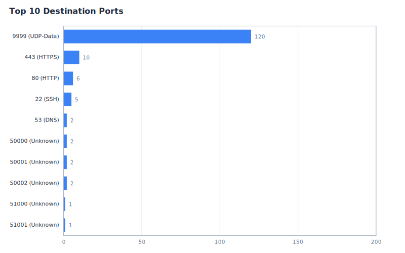

# pcapstat

**pcapstat** is a command-line tool for Linux, written in C11. It analyzes TCP and UDP traffic in one or more `.pcap` capture files. For each run it writes four PNG charts and a multi-page PDF report covering traffic statistics, top talkers, ports, flows and detected network anomalies.

The project was built as the qualification task for the *Best Coding Marathon* hackathon.

<p align="center">
  
  
</p>

## Key features

- **Multi-file input.** Several captures are merged into a single analysis.
- **Link layers:** Ethernet II (including 802.1Q and QinQ VLAN tags), Linux cooked capture (`SLL` and `SLL2`) and raw IP. Both IPv4 and IPv6 are supported.
- **Safe parsing.** Every header read is bounds-checked against `caplen` and copied with `memcpy()` (no unaligned pointer casts). Truncated or illegal packets are counted as malformed instead of crashing the tool.
- **Streaming statistics.** Packets are never kept in memory. Hosts, ports, flows and one-second time buckets are stored in sparse hash tables, so memory grows with the number of distinct entities, not with capture length.
- **Traffic characteristics:** protocol mix, packet-size histogram, TCP flag counts, Top-10 hosts, destination ports (with service names) and directional flows, plus detection of TCP retransmissions.
- **Seven anomaly heuristics:** port scan, SYN flood, retransmissions, RST spike, suspicious TCP flags, UDP burst and malformed packets.
- **Cairo rendering.** The same drawing code produces the standalone PNGs and the vector charts embedded in an A4 PDF report, which has automatic text wrapping and pagination.
- **Hardened build.** The code compiles with no warnings under `-Wall -Wextra -Wpedantic -Wshadow`, with `-Werror` in the debug and ASan builds. The test suite runs under AddressSanitizer and UndefinedBehaviorSanitizer, and a Valgrind target is provided.

## Architecture

```
        .pcap file(s)
              │
              ▼
   ┌──────────────────────┐
   │        Parser        │
   │       libpcap        │
   └──────────────────────┘
              │ parsed_packet_t (callback)
              ▼
   ┌──────────────────────┐
   │     Stats Engine     │
   │      hash tables     │
   └──────────────────────┘
              │ stats_ctx_t
              ▼
   ┌──────────────────────┐
   │   Anomaly Detector   │
   └──────────────────────┘
              │ anomaly_list_t
              ▼
   ┌──────────────────────┐
   │    Cairo PNG / PDF   │
   │  charts.c, report.c  │
   └──────────────────────┘
```

| Module | Header | Responsibility |
| :--- | :--- | :--- |
| CLI | [`include/cli.h`](include/cli.h) | `getopt_long()` parsing, input validation, output-directory creation |
| Parser | [`include/parser.h`](include/parser.h) | Opens captures with `pcap_open_offline()`, decodes L2/L3/L4 and calls a callback for every frame |
| Hash table | [`include/hashtable.h`](include/hashtable.h) | Generic hash table with separate chaining (FNV-1a hash, resizes above a 0.7 load factor) |
| Stats | [`include/stats.h`](include/stats.h) | Global counters, time series, hosts, ports, flows, retransmissions, Top-N rankings |
| Anomaly | [`include/anomaly.h`](include/anomaly.h) | Threshold-based heuristics; findings sorted by severity |
| Charts | [`include/charts.h`](include/charts.h) | Four charts drawn onto any `cairo_t` (used for both PNG and PDF) |
| Report | [`include/report.h`](include/report.h) | A4 PDF report with summary, tables, charts and anomaly pages |

### Key engineering choices

The full design notes are in [`ARCHITECTURE.md`](ARCHITECTURE.md).

- **Unified error handling.** Every public function returns `0` on success or a negative value from `enum pcapstat_err` (`PCAPSTAT_ERR_ARGS`, `_IO`, `_PCAP`, `_NOMEM`, `_RENDER`). Resources are released through a single `goto cleanup` path.
- **Explicit memory ownership.** Each header documents who allocates and who frees each object. Contexts follow an `_init()` / `_free()` pairing. Callback packet pointers and Top-N results are borrowed, never owned by the caller.
- **Every packet belongs to exactly one category:** `tcp + udp + other + malformed == total_packets`. A truncated TCP packet counts as malformed, not as TCP.
- **Accurate rates on long captures.** Above 120 time buckets, the timeline is downsampled into 120 groups. Each group records `span_sec`, so rates stay correct across gaps in the capture.
- **Wrap-safe TCP sequence numbers.** Retransmission detection compares sequence numbers with signed modular arithmetic, `(int32_t)(seq - max_seq) <= 0`.
- **One drawing path.** Chart functions take a borrowed `cairo_t *` and a bounding box and isolate their state with `cairo_save()` / `cairo_restore()`. The PDF therefore embeds true vector charts rather than raster images.

## Dependencies

You need a C11 compiler (GCC), GNU Make, `pkg-config`, `libpcap`, `libcairo` and `libm`. Valgrind is only needed for `make valgrind`. The `file` utility is used by the integration tests.

**Debian / Ubuntu**

```sh
sudo apt update
sudo apt install build-essential pkg-config libpcap-dev libcairo2-dev valgrind file
```

**Fedora**

```sh
sudo dnf install gcc make pkgconf-pkg-config libpcap-devel cairo-devel libasan libubsan valgrind file
```

**Arch Linux**

```sh
sudo pacman -S --needed base-devel pkgconf libpcap cairo valgrind file
```

## Build and test

| Command | Result |
| :--- | :--- |
| `make` | Optimized release build: `bin/pcapstat` (`-O2`) |
| `make debug` | Debug build: `bin/pcapstat-debug` (`-g -O0 -Werror`) |
| `make asan` | Sanitizer build: `bin/pcapstat-asan` (`-fsanitize=address,undefined -Werror`) |
| `make unit-test` | Builds and runs the unit tests in `tests/test_*.c` under ASan/UBSan |
| `make test` | Builds every target, then runs the unit tests and the integration suite [`tests/run_tests.sh`](tests/run_tests.sh) |
| `make valgrind ARGS="..."` | Runs `bin/pcapstat-debug` under Valgrind with `--leak-check=full`. Exits non-zero on any error |
| `make gen-sample` | Rebuilds `samples/demo.pcap` from the synthetic traffic generator [`tests/gen_demo_pcap.c`](tests/gen_demo_pcap.c) |
| `make clean` | Removes `bin/` and `build/` |

A typical first session:

```sh
make
make test
make valgrind ARGS="-i samples/demo.pcap -o /tmp/pcapstat_vg"
```

The integration suite checks the following and removes its temporary directories when it exits:

- CLI error handling: no arguments, a missing file, an invalid threshold, an unknown flag.
- `--help` and `--version`.
- One-file and multi-file runs of the release and ASan binaries.
- That the `file` command recognizes each PNG and the PDF as valid.
- That the output contains no ASan/UBSan reports.

## Usage

```
pcapstat [OPTIONS] [FILE...]
```

| Flag | Argument | Default | Description |
| :--- | :--- | :--- | :--- |
| `-i`, `--input` | `<file.pcap>` | *(required)* | Input capture file. Repeat the flag for several files. |
| `-o`, `--output` | `<dir>` | `./pcapstat_out` | Output directory. Created if missing (mode `0755`). |
| `--portscan-threshold` | `<N>` | `20` | Number of distinct destination ports at which a host is flagged as a port scanner. |
| `-v`, `--verbose` | | off | Print each input file to stderr while it is processed. |
| `-h`, `--help` | | | Print usage and exit `0`. |
| `-V`, `--version` | | | Print the version and exit `0`. |

Positional arguments after the options are treated as additional input files. The tool exits with `0` on success and `1` on any error (bad arguments, an unreadable input, a parse or render failure).

### Examples

Analyze the bundled demo capture:

```sh
./bin/pcapstat -i samples/demo.pcap -o out
```

Merge several captures into a single report (positional files work too):

```sh
./bin/pcapstat -i samples/demo.pcap -i samples/demo.pcap -o out_multi
./bin/pcapstat -o out_multi samples/demo.pcap
```

Use a more sensitive port-scan threshold with verbose progress:

```sh
./bin/pcapstat -v --portscan-threshold 10 -i samples/demo.pcap -o out
```

Sample output:

```
pcapstat 0.1.0: analysis complete in 0.075 s
  Files processed : 1
  Packets         : 183 (18075 bytes)
  Anomalies       : 6 (critical 3, warning 3, info 0)
  Outputs:
    out/traffic_timeline.png
    out/protocol_ports.png
    out/packet_sizes.png
    out/tcp_flags.png
    out/report.pdf
```

### Generated files

| File | Contents |
| :--- | :--- |
| `traffic_timeline.png` | TCP and UDP packets per second over time |
| `protocol_ports.png` | Protocol mix and top destination ports |
| `packet_sizes.png` | Packet-size histogram |
| `tcp_flags.png` | TCP flag distribution, including suspicious combinations |
| `report.pdf` | A4 report. Page 1: executive summary and KPI cards. Page 2: Top-10 talkers, ports and flows. Page 3: 2×2 vector chart grid. Page 4 onwards: detected anomalies with severity badges and `Page X of Y` footers |

## Anomaly heuristics

Default thresholds are defined in [`include/common.h`](include/common.h). The port-scan threshold can be changed at run time with `--portscan-threshold`. The other thresholds are compile-time constants. Findings are sorted CRITICAL → WARNING → INFO, with ties broken deterministically by category, subject and description.

| Heuristic | Condition | Default threshold | Severity |
| :--- | :--- | :--- | :--- |
| **Port Scan** | A host contacts at least `portscan_threshold` distinct destination ports (SYN/UDP) | `20` ports | CRITICAL |
| **SYN Flood** | Per host or globally: `SYN >= syn_flood_min` and `SYN / SYN-ACK > syn_ratio` | `≥ 50` SYNs, ratio `> 3.0` | CRITICAL |
| **TCP Retransmissions** | Per flow: `retrans / packets > retrans_pct` (only flows with at least 20 packets). Globally: `retrans / tcp_packets > retrans_pct` (at least 20 TCP packets) | `> 5.0 %` | WARNING |
| **RST Spike** | `rst / tcp_packets > rst_pct` (at least 30 TCP packets) | `> 10.0 %` | WARNING |
| **Suspicious TCP Flags** | Any Null (no flags), Xmas (FIN+PSH+URG), SYN+FIN or SYN+RST segment | `> 0` packets | CRITICAL |
| **UDP Burst / Flood** | A one-second window with `udp >= udp_burst_min` and `udp > udp_burst_mult × mean` | `≥ 100` pkt/s and `> 3.0×` the mean | WARNING |
| **Malformed Packets** | `malformed_packets > 0` (truncated headers, illegal IHL or length fields) | `> 0` packets | WARNING |

`samples/demo.pcap` is a synthetic capture generated by [`tests/gen_demo_pcap.c`](tests/gen_demo_pcap.c). It is built to trigger several of these rules, so you can see them in the report.

## Known limitations

- **Non-IP frames count as malformed.** Frames such as ARP, LLDP or STP are marked `is_malformed` by the parser, so `malformed_packets` really means "malformed + non-IP".
- **IPv6 extension headers are not followed.** TCP or UDP carried behind an extension header is counted as "other".
- **IPv4 fragments are not reassembled.** Non-first fragments are still decoded as L4, so their ports and flags are unreliable.
- **Limited container format support.** Input is read through `pcap_open_offline()`, and only the classic `.pcap` format is tested. One link type is assumed per file, so pcapng files with several interfaces are not supported.
- **Most thresholds are fixed at build time.** Only the port-scan threshold is exposed on the command line.
- **Single-threaded.** Files are processed one after another.

## Future work

- Full pcapng support, with per-interface link types and metadata.
- A separate non-IP counter, IPv6 extension-header walking and IPv4 fragment reassembly.
- Application-layer (L7) inspection: DNS, HTTP and TLS SNI.
- Multi-threaded processing, either one worker per file or sharded flow tables.
- CLI flags (or a config file) for every anomaly threshold, plus JSON/CSV export of statistics.
